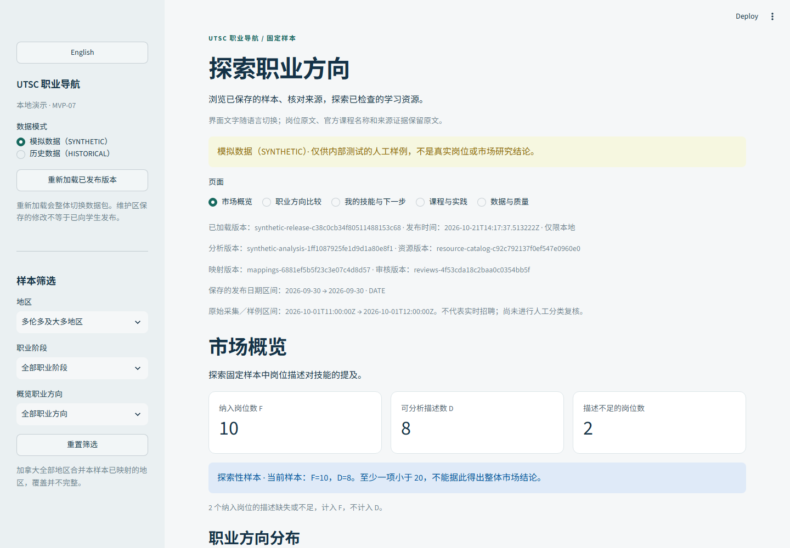

# UTSC Career & Opportunity Navigator

面向 UTSC 学生的职业与实践导航项目。此仓库独立管理网站开发、项目文档和现有中英文 Demo。

**当前有两个可运行部分**：根目录 Streamlit 中英文模拟 Demo（启动方式见下），
以及 `web/` 下 A0–A3 交付的 React＋TypeScript＋Vite 网站（基础导航、共同
合同样例、运行时校验、中英文切换、真实 Supabase Auth 账户、市场概览／
方向比较，以及课程完成自述、私有经历、本地候选技能抽取和显式确认，见
[web/README.md](web/README.md)）。
生产部署尚未进行；GitHub 仓库上传不代表网站已部署。



## 旧 Streamlit Demo 功能

以下列表描述根目录 Demo；A2 正式网站页面在 `web/`，两者数据与账号状态
互相独立。

- 市场概览：职业方向、地区、职业阶段筛选，显示样本量及可分析描述分母。
- 两个方向比较：技能提及率、零分母提示、来源和日期、CSV 下载。
- 会话画像：自述、技能选择、最多三条固定规则建议和个人 Markdown 下载。
- 课程与实践：带来源的课程摘要、独立练习、核对状态和机会空状态。
- 数据质量：纳入／待审／排除、技能依据及完整发布来源。
- **全局 English／中文 一键切换**，保留当前会话筛选、比较方向及填写内容；语言通过网址参数保留。

岗位原文、官方课程名称和来源证据保持原文，机器可读 CSV 保留稳定字段。
旧 Demo 的个人资料只保存在当前会话；`web/` 的 A1 已提供真实 Supabase
账户与本人资料读写，但收藏仍未实现。

## 快速启动

已在 Windows、Python 3.12.14 验证；准备好自己的 Python 3.12 后运行：

```powershell
git clone https://github.com/glh5835/UTSC.git
Set-Location UTSC
py -3.12 -m venv .venv
& .\.venv\Scripts\python.exe -m pip install --only-binary=:all: -r requirements-lock.txt
& .\.venv\Scripts\python.exe -X utf8 scripts/prepare_demo.py
& .\.venv\Scripts\python.exe -X utf8 run_local.py
```

然后打开控制台给出的地址，默认 `http://127.0.0.1:8510`。环境准备后也可双击根目录 `启动 UTSC 职业导航.bat`。首次准备只生成被 Git 忽略的模拟运行状态，已有有效发布直接复用，不覆盖既有维护记录。首次依赖安装需要包源网络，不需要招聘或模型 API key。

详见[启动与检查说明](docs/app_setup.md)。[英文界面截图](docs/images/demo-en.png)和[手机界面截图](docs/images/demo-mobile-zh.png)供预览。

## 数据状态

当前岗位是 **SYNTHETIC 人工样例**，不是实时招聘或市场研究结果。固定基线 F=10、D=8，SQL 4/8、Python 3/8；提及不等于必需技能，也不表示个人能力。HISTORICAL 尚无真实发布时显示空状态。

课程是带来源与核对日期的历史摘要，不保证当期开设、名额或个人资格。当前真实精选活动为 0。社团账号表只是候选来源清单。

## 目录与分工

| 路径 | 用途 |
| --- | --- |
| `app.py`、`utsc_nav/` | 当前 Streamlit Demo |
| `data/synthetic/` | 旧 Demo 的人工固定输入及分析样例 |
| `data/resources/` | 旧课程与实践资源摘要、来源与练习 |
| `tests/`、`scripts/` | 本 Demo 的检查与显式准备工具 |
| `web/` | A0–A3 React＋TypeScript＋Vite 网站：导航、合同样例、运行时校验、账户、市场与比较、课程／经历与显式技能确认（`cd web && npm ci && npm run dev`） |
| `supabase/` | A1／A3 数据库迁移与本地隔离栈配置（`npx supabase start`，需要 Docker） |
| `docs/`、`plans/` | 当前开发说明、冻结计划书和历史阶段记录 |

数据负责人 Seraphina 的 [Python 数据仓库](https://github.com/wangzhuxirou-svg/Canadian-Early-Career-Data-Analytics-Job-Market)保持独立，本仓库不包含其管线和真实招聘包。后续消费双方约定的公开合同包；根目录旧模拟契约不能冒充新 S0 v1。

## 验证与后续

```powershell
& .\.venv\Scripts\python.exe -m pytest tests -q
```

2026-10-27 中英文 Demo 实际通过 **231 项程序测试和 15 组浏览器检查**。页面和控制台错误均为 0，包含手机和键盘操作；见[验证摘要](docs/verification/demo-20261027.json)。本机检查不代表真实市场、多人权限、生产部署或异机安装验收。

阶段记录：A0 已于 2026-10-27 在 `web/` 完成——React＋TypeScript＋Vite
骨架、合同 v1（上游 `b828553f`）schemas 与三组 fixtures 原样同步、
运行时数据校验层、导航与只读样例展示、中英文切换与空／错／加载／旧数据
状态（[阶段记录](plans/阶段记录/A0.md)）。A1 已于 2026-10-27 完成
真实 Supabase Auth、六表迁移与 RLS（[阶段记录](plans/阶段记录/A1.md)），
2026-10-28 按独立复核完成账号隔离修复、真实权限矩阵验收与合同溯源
修正（见 A1 记录的复核章节）。A2 已于 2026-10-28 完成本地功能验收：
八角色市场概览、筛选、技能提及率、角色比较及中英／手机／异常状态回归通过
（[阶段记录](plans/阶段记录/A2.md)）；未合并数据候选的隔离联调通过，但正式
1.1 合同升级与真实数据发布仍待双方决定。A3 已于 2026-10-28 完成课程完成
自述、私有经历、本地英文候选抽取与显式技能确认，并通过真实 A1+A3 权限
矩阵和浏览器流程（[阶段记录](plans/阶段记录/A3.md)）。A4–A8 未开始。

阅读[项目文档导航](docs/README.md)、[冻结计划书](docs/references/UTSC_Two_Person_Code_Plan.docx)、[数据协作边界](docs/data-integration.md)和 [AGENTS.md](AGENTS.md)。不要提交依赖环境、数据库、密钥、聊天、个人下载或原始招聘响应。
